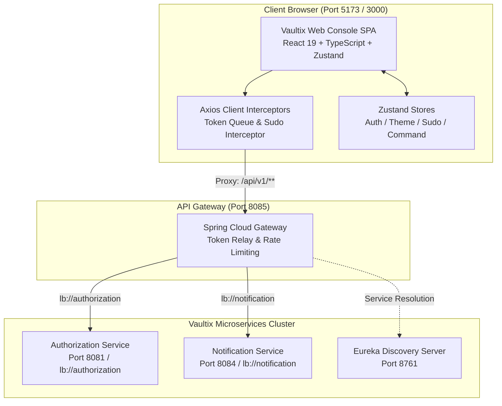

# Vaultix Web Console

[](https://react.dev/)
[](https://www.typescriptlang.org/)
[](https://vitejs.dev/)
[](https://tailwindcss.com/)
[](https://github.com/pmndrs/zustand)
[](https://tanstack.com/query)
[](https://simplewebauthn.dev/)
[](LICENSE)

Modern, high-performance **Identity & Access Management (IAM)** Single Page Application (SPA) for the **Vaultix** enterprise platform. Crafted with **React 19**, **TypeScript 6**, **Vite 8**, **Tailwind CSS v4**, and **Zustand 5**, the console features a high-contrast Clerk-inspired monochrome aesthetic, glassmorphic elevation, responsive mobile drawers, universal keyboard navigation (`Cmd+K` / `Ctrl+K`), biometric passkeys, zero-trust token rotation, and transparent Sudo mode elevation.

---

## Service Overview

| Specification | Details |
| :--- | :--- |
| **Development Port** | `5173` (`http://localhost:5173`) |
| **Production Preview Port** | `3000` (`http://localhost:3000`) |
| **Core Framework** | React 19.3.1 + TypeScript 6.0.3 + Vite 8.3.4 |
| **Design System** | Tailwind CSS v4 + Radix UI Primitives + Lucide Icons 1.61+ |
| **State Management** | Zustand 5 (Auth, Theme, Sudo, Command Palette) + TanStack React Query 5 |
| **Authentication Suites** | Passkeys (WebAuthn / FIDO2 Level 3), TOTP Authenticator, SMS MFA, Emergency Recovery Codes, Google OIDC, GitHub OAuth2 |
| **Security Guards** | Silent boot refresh, Axios token rotation concurrency queues, automatic 403 Sudo challenge interception & replay |
| **API Gateway Target** | Routes `/api/v1/**` via Spring Cloud Gateway (`http://localhost:8085`) |

---

## Architectural Data Flow



---

## Documentation Index

In-depth technical architecture, client-side security flows, component catalogs, and design system tokens are maintained in the [`docs/`](docs/) directory:

| Document | Focus Areas |
| :--- | :--- |
| 📖 [**Frontend Architecture & Design**](file:///c:/Users/vimal/Documents/Projects/Vaultix/ui/docs/ARCHITECTURE.md) | Client-side routing guards, Axios token rotation concurrency queues, Sudo Mode (`403` auto-interception and replay), WebAuthn biometric ceremonies, RBAC permission evaluation engine (`*`, `domain:*`, exact), and social account identity federation. |
| 🎨 [**UI Components & Design System**](file:///c:/Users/vimal/Documents/Projects/Vaultix/ui/docs/COMPONENTS.md) | Clerk/Linear-inspired design tokens, Tailwind CSS v4 surface layering, Radix UI primitives, the 245+ country `PhoneInput` with ISO 3166-1 database, `CommandPalette` (`cmdk`), modals, and theme switching. |

---

## Key Capabilities & Feature Modules

### 1. Robust Client-Side Security & Token Rotation
- **In-Memory Access Tokens**: Short-lived JWTs stored strictly in application state, never exposed to `localStorage`.
- **`HttpOnly` Refresh Cookies**: Refresh tokens are stored in secure cookies (`SameSite=Strict`), preventing XSS exfiltration.
- **Concurrency Refresh Queue**: If multiple concurrent API requests encounter an expired access token (`401 Unauthorized`), the first request initiates token rotation while concurrent requests are parked in a promise queue and resolved seamlessly upon renewal.
- **Credential Error Isolation**: 401 errors resulting from invalid credentials (e.g., incorrect password in sudo elevation) bypass token refresh to prevent session invalidation loops.

### 2. Transparent Sudo Mode Elevation (`SudoModal`)
- When accessing high-risk endpoints (e.g., password modification, passkey deletion, recovery code regeneration), the backend responds with `403 Forbidden` (`x-sudo-required: true` or code `SUDO_REQUIRED`).
- The Axios response interceptor pauses the pending request and launches the [`SudoModal`](file:///c:/Users/vimal/Documents/Projects/Vaultix/ui/src/features/sudo/SudoModal.tsx).
- Upon successful elevation via Password, Passkey, or TOTP, the pending request is automatically replayed and resolved without requiring page reloads or user re-navigation.

### 3. Biometric Passkeys (FIDO2 / WebAuthn Level 3)
- Integrates [`@simplewebauthn/browser`](file:///c:/Users/vimal/Documents/Projects/Vaultix/ui/src/features/passkeys/PasskeysPage.tsx) for hardware-bound passkeys (Touch ID, Face ID, Windows Hello, YubiKey).
- Supports passwordless biometric sign-in directly on the login form and credential lifecycle actions (register, rename nickname, delete).

### 4. Multi-Factor Authentication Suite (`/mfa`)
- **Authenticator App (RFC 6238 TOTP)**: Dynamic QR code presentation (`otpauth://`), manual Base32 key display, 6-digit verification ceremony, and 10 single-use emergency recovery codes generation.
- **SMS MFA**: Phone number verification prerequisite, 60-second cooldown timer, and SMS OTP verification.
- **Emergency Recovery Codes**: Real-time remaining count, secure grid display with one-click **Copy All**, and secure code regeneration.

### 5. International Phone Selector & Privacy Masking
- The [`PhoneInput`](file:///c:/Users/vimal/Documents/Projects/Vaultix/ui/src/components/ui/PhoneInput.tsx) primitive features a complete ISO 3166-1 database of 245+ countries with real-time search, flag assets, and dial code resolution.
- **Privacy by Default**: Phone numbers are masked across dashboards and modals (e.g., `+1 555-***-1234`). An interactive **Eye / EyeOff** toggle allows users to securely reveal or conceal their phone number.

### 6. Administration Suite (RBAC & Platform Security)
- **User Management** ([`/admin/users`](file:///c:/Users/vimal/Documents/Projects/Vaultix/ui/src/features/admin-users/UsersPage.tsx)): Search, filter, inspect MFA postures, lock/unlock accounts, assign roles, and soft-delete users.
- **Roles & Hierarchies** ([`/admin/roles`](file:///c:/Users/vimal/Documents/Projects/Vaultix/ui/src/features/admin-roles/RolesPage.tsx)): Role creation, description, hierarchy levels, and granular permission attachments.
- **Permissions Catalog** ([`/admin/permissions`](file:///c:/Users/vimal/Documents/Projects/Vaultix/ui/src/features/admin-permissions/PermissionsPage.tsx)): System-wide RBAC permissions directory with scope filtering.
- **Signing Keys Inspector** ([`/admin/signing-keys`](file:///c:/Users/vimal/Documents/Projects/Vaultix/ui/src/features/signing-keys/SigningKeysPage.tsx)): Live inspection of active, retiring, and expired JWKS asymmetric keys (KID, algorithm, issue and expiration timestamps).

### 7. Global Command Palette (`Cmd+K` / `Ctrl+K`)
- Powered by `cmdk` and [`CommandPalette.tsx`](file:///c:/Users/vimal/Documents/Projects/Vaultix/ui/src/components/ui/CommandPalette.tsx).
- Provides instant search across navigation destinations, quick actions, theme switches, and administrative portals from anywhere in the application.

---

## Route Catalog

| Path | Access Level | Component | Purpose |
| :--- | :--- | :--- | :--- |
| `/login` | Public | [`LoginForm`](file:///c:/Users/vimal/Documents/Projects/Vaultix/ui/src/features/auth/components/LoginForm.tsx) | Credentials, biometric passkey sign-in, MFA challenges, and OAuth |
| `/register` | Public | [`RegisterPage`](file:///c:/Users/vimal/Documents/Projects/Vaultix/ui/src/features/auth/components/RegisterPage.tsx) | User registration with international phone selector |
| `/forgot-password` | Public | [`ForgotPasswordPage`](file:///c:/Users/vimal/Documents/Projects/Vaultix/ui/src/features/auth/components/ForgotPasswordPage.tsx) | Password recovery code request and verification |
| `/email-revert` | Public | [`EmailRevertPage`](file:///c:/Users/vimal/Documents/Projects/Vaultix/ui/src/features/auth/components/EmailRevertPage.tsx) | 7-day emergency email address rollback verification |
| `/oauth/callback/github` | Public | [`GitHubCallbackPage`](file:///c:/Users/vimal/Documents/Projects/Vaultix/ui/src/features/auth/components/GitHubCallbackPage.tsx) | GitHub OAuth2 authorization code callback processing |
| `/dashboard` | Protected | [`DashboardPage`](file:///c:/Users/vimal/Documents/Projects/Vaultix/ui/src/features/dashboard/DashboardPage.tsx) | User profile, verified status badges, privacy toggles, and modals |
| `/connected-accounts` | Protected | [`ConnectedAccountsPage`](file:///c:/Users/vimal/Documents/Projects/Vaultix/ui/src/features/connected-accounts/ConnectedAccountsPage.tsx) | Google OIDC and GitHub OAuth2 1-click connect/unlink |
| `/sessions` | Protected | [`SessionsPage`](file:///c:/Users/vimal/Documents/Projects/Vaultix/ui/src/features/sessions/SessionsPage.tsx) | Concurrent device/IP sessions list and selective revocation |
| `/mfa` | Protected | [`MfaPage`](file:///c:/Users/vimal/Documents/Projects/Vaultix/ui/src/features/mfa/MfaPage.tsx) | TOTP Authenticator, SMS MFA, and emergency recovery codes |
| `/passkeys` | Protected | [`PasskeysPage`](file:///c:/Users/vimal/Documents/Projects/Vaultix/ui/src/features/passkeys/PasskeysPage.tsx) | WebAuthn biometric security keys registration and lifecycle |
| `/admin/users` | Admin Protected | [`UsersPage`](file:///c:/Users/vimal/Documents/Projects/Vaultix/ui/src/features/admin-users/UsersPage.tsx) | User directory, lock/unlock, roles assignment, status inspection |
| `/admin/roles` | Admin Protected | [`RolesPage`](file:///c:/Users/vimal/Documents/Projects/Vaultix/ui/src/features/admin-roles/RolesPage.tsx) | Role definitions, permission mapping, hierarchy assignment |
| `/admin/permissions` | Admin Protected | [`PermissionsPage`](file:///c:/Users/vimal/Documents/Projects/Vaultix/ui/src/features/admin-permissions/PermissionsPage.tsx) | RBAC permission catalog inspection |
| `/admin/signing-keys` | Admin Protected | [`SigningKeysPage`](file:///c:/Users/vimal/Documents/Projects/Vaultix/ui/src/features/signing-keys/SigningKeysPage.tsx) | Asymmetric JWKS signing key rotation monitor |

---

## Directory Structure

```
ui/
├── index.html                                        # HTML5 entry template with dark mode hydration script
├── package.json                                      # Dependencies (React 19, Vite 8, Tailwind v4, Zustand 5)
├── vite.config.ts                                    # Vite reverse proxy & Rollup manualChunk configuration
├── tsconfig.json                                     # TypeScript configuration
├── README.md                                         # Web Console documentation
├── docs/
│   ├── ARCHITECTURE.md                               # Deep dive frontend architecture & security guide
│   └── COMPONENTS.md                                 # Design system tokens, primitives & modal catalogs
└── src/
    ├── App.tsx                                       # Root application provider wrapper
    ├── main.tsx                                      # React 19 createRoot entry point
    ├── index.css                                     # Tailwind CSS v4 setup, surface tokens & animations
    ├── components/
    │   ├── layout/
    │   │   ├── AppLayout.tsx                         # Protected layout containing Sidebar, TopNav & SudoModal
    │   │   ├── Sidebar.tsx                           # Desktop navigation and responsive mobile drawer
    │   │   └── TopNav.tsx                            # Header navigation, CommandPalette trigger & UserButton
    │   └── ui/
    │       ├── badge.tsx                             # Status badges (default, secondary, success, outline)
    │       ├── button.tsx                            # Radix Slot button with variant styling
    │       ├── card.tsx                              # Composable card primitives with specular borders
    │       ├── command.tsx                           # cmdk dialog and command list primitives
    │       ├── CommandPalette.tsx                    # Global keyboard shortcut Cmd+K / Ctrl+K palette
    │       ├── countries.ts                          # 245+ countries ISO 3166-1 database
    │       ├── input.tsx                             # Focus-ring input with error state support
    │       ├── Logo.tsx                              # Vaultix brand shield logo
    │       ├── LogoutAllModal.tsx                    # Modal to revoke all active user sessions
    │       ├── LogoutOtherModal.tsx                  # Modal to revoke all sessions except the current one
    │       ├── PhoneInput.tsx                        # Enterprise international phone selector with search
    │       ├── skeleton.tsx                          # Skeleton loading animation placeholders
    │       ├── ThemeToggle.tsx                       # Animated theme switcher (Light, Dark, System)
    │       └── UserButton.tsx                        # Profile avatar dropdown menu
    ├── features/
    │   ├── admin-permissions/                        # System-wide permission catalog
    │   │   ├── PermissionsPage.tsx
    │   │   └── api/permissionsApi.ts
    │   ├── admin-roles/                              # RBAC role definitions & assignment
    │   │   ├── RolesPage.tsx
    │   │   └── api/rolesApi.ts
    │   ├── admin-users/                              # Enterprise user management
    │   │   ├── UsersPage.tsx
    │   │   └── api/usersApi.ts
    │   ├── auth/                                     # Authentication pages & OAuth callbacks
    │   │   ├── api/authApi.ts
    │   │   └── components/
    │   │       ├── EmailRevertPage.tsx
    │   │       ├── ForgotPasswordPage.tsx
    │   │       ├── GitHubCallbackPage.tsx
    │   │       ├── GitHubSignInButton.tsx
    │   │       ├── GoogleSignInButton.tsx
    │   │       ├── LoginForm.tsx
    │   │       └── RegisterPage.tsx
    │   ├── connected-accounts/                       # Social account linking (Google, GitHub)
    │   │   └── ConnectedAccountsPage.tsx
    │   ├── dashboard/                                # Self-service profile management
    │   │   ├── DashboardPage.tsx
    │   │   └── components/
    │   │       ├── ChangeEmailModal.tsx
    │   │       ├── ChangeFullNameModal.tsx
    │   │       ├── ChangePasswordModal.tsx
    │   │       ├── ChangePhoneNumberModal.tsx
    │   │       ├── ChangeUsernameModal.tsx
    │   │       ├── DeleteAccountModal.tsx
    │   │       ├── VerifyEmailModal.tsx
    │   │       └── VerifyPhoneModal.tsx
    │   ├── mfa/                                      # Multi-factor authentication
    │   │   └── MfaPage.tsx
    │   ├── passkeys/                                 # WebAuthn biometric passkeys
    │   │   ├── PasskeysPage.tsx
    │   │   └── components/
    │   │       ├── DeletePasskeyModal.tsx
    │   │       ├── RegisterPasskeyModal.tsx
    │   │       └── RenamePasskeyModal.tsx
    │   ├── sessions/                                 # Active session management
    │   │   ├── SessionsPage.tsx
    │   │   └── api/sessionsApi.ts
    │   ├── signing-keys/                             # JWKS signing key rotation inspection
    │   │   └── SigningKeysPage.tsx
    │   └── sudo/                                     # Sudo elevation modal & auto-replay
    │       └── SudoModal.tsx
    ├── lib/
    │   ├── api-client.ts                             # Axios client with refresh queue & sudo interceptor
    │   ├── query-client.ts                           # TanStack Query client configuration
    │   └── utils.ts                                  # Class merging utility (clsx + tailwind-merge)
    ├── routes/
    │   └── AppRoutes.tsx                             # Lazy-loaded routes and ProtectedRoute guard
    ├── stores/
    │   ├── authStore.ts                              # Auth state, silent refresh, profile & RBAC checks
    │   ├── commandStore.ts                           # Command palette open/close state
    │   ├── sudoStore.ts                              # Sudo challenge promise queue
    │   └── themeStore.ts                             # Theme preference & system preference listener
    └── types/
        └── api.ts                                    # Shared API response interfaces & DTO contracts
```

---

## Configuration Reference

### 1. Reverse Proxy Configuration
Configured in [`vite.config.ts`](file:///c:/Users/vimal/Documents/Projects/Vaultix/ui/vite.config.ts) to forward `/api` requests to Spring Cloud Gateway:

```typescript
server: {
  port: 5173,
  proxy: {
    '/api': {
      target: 'http://localhost:8085',
      changeOrigin: false,
    },
  },
},
preview: {
  port: 3000,
}
```

### 2. Environment Variables
Configured in `.env` (derived from [`.env.example`](file:///c:/Users/vimal/Documents/Projects/Vaultix/ui/.env.example)):

| Variable | Description | Default / Example |
| :--- | :--- | :--- |
| `VITE_GOOGLE_CLIENT_ID` | Google OAuth2 / OIDC Client ID | `867635310817-...apps.googleusercontent.com` |
| `VITE_GITHUB_CLIENT_ID` | GitHub OAuth App Client ID | `your_github_client_id_here` |

### 3. Production Chunk Splitting
Production assets are partitioned into optimized vendor bundles:
- `vendor-react`: React 19, React DOM, React Router DOM.
- `vendor-tanstack`: TanStack React Query, TanStack Table.
- `vendor-charts`: Recharts charting library.
- `vendor-icons`: Lucide React icon suite.

---

## Quick Start & Developer Runbook

### 1. Prerequisites
- **Node.js 20+** or **Node.js 22+**
- Active Vaultix infrastructure services running via Docker:
  ```powershell
  docker compose -f infra/docker-compose.yml up -d
  ```

### 2. Install Dependencies
```powershell
npm install
```

### 3. Launch Development Server
```powershell
npm run dev
```
Open [http://localhost:5173](http://localhost:5173) in your browser.

### 4. Code Quality & Linting
Run static analysis via Oxlint:
```powershell
npm run lint
```

### 5. Production Build & Local Preview
```powershell
npm run build
npm run preview
```
Open [http://localhost:3000](http://localhost:3000) to test the production bundle locally.
