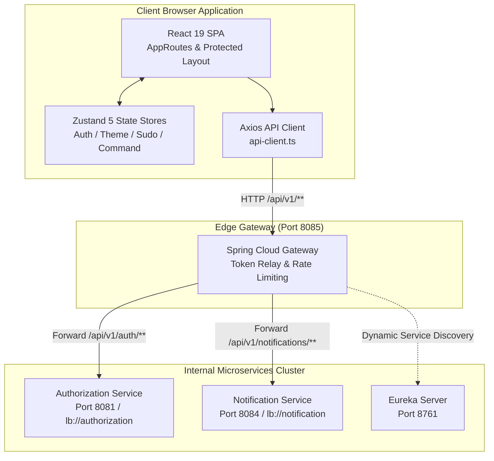
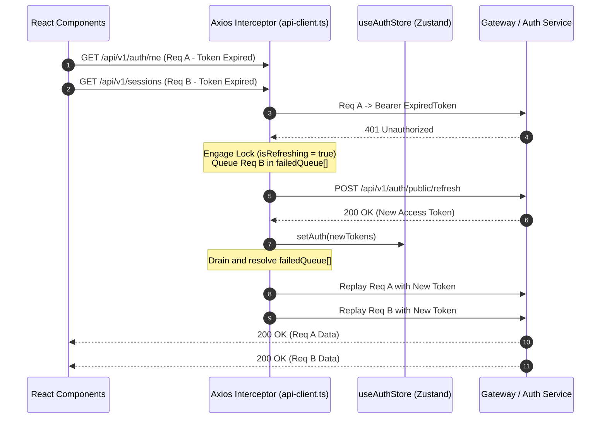
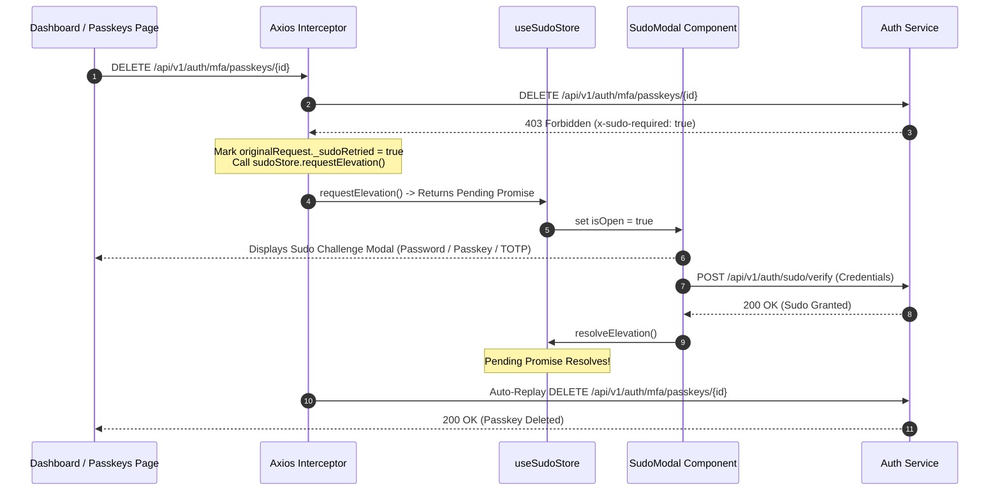

# Vaultix Web Console - Frontend Architecture & Technical Design

Comprehensive technical documentation detailing the client-side security architecture, state management lifecycles, token rotation concurrency queues, transparent Sudo mode elevation, and biometric ceremony integrations governing the **Vaultix Web Console**.

---

## 1. System Architecture & Topology

The Vaultix Web Console is built as an enterprise-grade Single Page Application (SPA). It communicates with the Vaultix backend cluster through the [Spring Cloud Gateway](file:///c:/Users/vimal/Documents/Projects/Vaultix/gateway/README.md) reverse proxy, isolating the frontend from internal microservice topologies.



---

## 2. Client-Side Routing & Access Control

Routing is orchestrated with **React Router 7** using asynchronous route-level code splitting via `React.lazy()` in [`AppRoutes.tsx`](file:///c:/Users/vimal/Documents/Projects/Vaultix/ui/src/routes/AppRoutes.tsx):

### 2.1 Route Partitioning
- **Public Routes**: Accessible without authentication (`/login`, `/register`, `/forgot-password`, `/email-revert`, `/oauth/callback/github`). When an already-authenticated user navigates to public routes, they are automatically forwarded to `/dashboard`.
- **Protected Layout (`AppLayout`)**: Wraps all authenticated features in [`AppLayout.tsx`](file:///c:/Users/vimal/Documents/Projects/Vaultix/ui/src/components/layout/AppLayout.tsx), mounting the [`Sidebar`](file:///c:/Users/vimal/Documents/Projects/Vaultix/ui/src/components/layout/Sidebar.tsx), [`TopNav`](file:///c:/Users/vimal/Documents/Projects/Vaultix/ui/src/components/layout/TopNav.tsx), [`SudoModal`](file:///c:/Users/vimal/Documents/Projects/Vaultix/ui/src/features/sudo/SudoModal.tsx), and [`CommandPalette`](file:///c:/Users/vimal/Documents/Projects/Vaultix/ui/src/components/ui/CommandPalette.tsx).
- **Administrative Portals**: Sub-routes under `/admin/*` (`/admin/users`, `/admin/roles`, `/admin/permissions`, `/admin/signing-keys`) are restricted by RBAC permission guards.

### 2.2 Boot Authentication & Silent Refresh
On initial application mount, `AppRoutes` triggers `checkAuthOnBoot()`:
1. Renders a full-screen **Enterprise Security Splash Screen** displaying the Vaultix brand shield and a verification indicator (`Verifying security context...`).
2. Dispatches a silent refresh request to `POST /api/v1/auth/public/refresh` utilizing the secure `HttpOnly` cookie or persisted refresh token.
3. If valid, populates the user profile (`GET /api/v1/auth/me`) and mounts protected routes seamlessly without flashing the login screen.
4. If expired or unauthenticated, transitions cleanly to public routes while preserving the target query location.

---

## 3. Token Rotation & Concurrency Refresh Queue

API calls are routed through the customized Axios client in [`api-client.ts`](file:///c:/Users/vimal/Documents/Projects/Vaultix/ui/src/lib/api-client.ts):

### 3.1 Token Separation Policy
- **Access Tokens**: Short-lived JWTs held strictly in memory (`useAuthStore`). Injected into protected API requests as `Authorization: Bearer <token>`.
- **Refresh Tokens**: Persisted in encrypted, `HttpOnly`, `SameSite=Strict` cookies, completely impervious to JavaScript access and Cross-Site Scripting (XSS) exfiltration.

### 3.2 Concurrency Lock & Promise Queue Flow



### 3.3 Credential Error Isolation
To prevent unwanted token refresh or logout loops when a user enters an incorrect password in a verification modal, the interceptor inspects the error context:
```typescript
/* Do not auto-refresh or logout if the 401 is a credential verification failure */
const isSudoVerification = originalRequest.url?.includes('/auth/sudo/verify') || 
                           originalRequest.url?.includes('/auth/sudo/passkey/verify')
const isCredentialError = isSudoVerification && 
  error.response?.data?.message && 
  !error.response.data.message.toLowerCase().includes('token') && 
  !error.response.data.message.toLowerCase().includes('jwt')

if (isCredentialError) {
  return Promise.reject(error)
}
```

---

## 4. Transparent Sudo Mode Elevation Architecture

When performing destructive operations (e.g., changing passwords, deleting passkeys, or regenerating emergency recovery codes), the backend requires elevated Sudo authentication.



### Key Technical Advantages
- **Zero Page Reloads**: The calling component never needs to handle 403 Sudo states manually.
- **Zero Loss of UI Context**: Form states, modal inputs, and component focus are retained while the user elevates permissions.
- **Automatic Request Replay**: Once elevated, the original API call automatically executes and resolves.

---

## 5. Granular RBAC & Wildcard Permission Engine

Role and permission checks are encapsulated within [`useAuthStore.ts`](file:///c:/Users/vimal/Documents/Projects/Vaultix/ui/src/stores/authStore.ts):

### 5.1 Role Evaluation (`hasRole`)
Normalizes role prefixes dynamically:
```typescript
hasRole: (role: string) => {
  const user = get().user
  if (!user || !user.roles) return false
  const cleanRole = role.startsWith('ROLE_') ? role.substring(5) : role
  return user.roles.some(
    (r) => r === role || r === `ROLE_${cleanRole}` || r === cleanRole
  )
}
```

### 5.2 Hierarchical Wildcard Permission Evaluation (`hasPermission`)
Supports three distinct evaluation tiers:
1. **Global Superadmin Wildcard (`*`)**: Grants access to all system capabilities.
2. **Domain-Level Wildcard (`domain:*`)**: E.g., `key:*` matches `key:read`, `key:write`, and `key:rotate`.
3. **Exact Permission Match**: E.g., `user:create` matches `user:create`.

```typescript
hasPermission: (permission: string) => {
  const user = get().user
  if (!user || !user.permissions || user.permissions.length === 0) return false
  const cleanPerm = permission.trim().toLowerCase()

  if (cleanPerm === '*') return true

  /* Domain wildcard query, e.g. "key:*" */
  if (cleanPerm.endsWith(':*')) {
    const domainPrefix = cleanPerm.slice(0, -1)
    return user.permissions.some((p) => {
      const cleanP = p.trim().toLowerCase()
      return cleanP === '*' || cleanP.startsWith(domainPrefix)
    })
  }

  /* Specific permission query, e.g. "key:read" matches "key:read", "key:*", or "*" */
  const domain = cleanPerm.split(':')[0]
  return user.permissions.some((p) => {
    const cleanP = p.trim().toLowerCase()
    return cleanP === '*' || cleanP === `${domain}:*` || cleanP === cleanPerm
  })
}
```

---

## 6. Biometric Passkeys (FIDO2 / WebAuthn Level 3)

Configured in [`PasskeysPage.tsx`](file:///c:/Users/vimal/Documents/Projects/Vaultix/ui/src/features/passkeys/PasskeysPage.tsx) using `@simplewebauthn/browser`:

### 6.1 Registration Ceremony
1. **Challenge Negotiation**: Frontend requests registration options:
   ```typescript
   const options = await authApi.getPasskeyRegistrationOptions()
   ```
2. **Platform Biometric Prompt**: Invokes browser authenticator ceremony:
   ```typescript
   const attestation = await startRegistration({ optionsJSON: options })
   ```
3. **Cryptographic Attestation Verification**: Submits attestation to `POST /api/v1/auth/webauthn/register`.
4. **State Synchronization**: Backend verifies the attestation signature and updates `user.passkey_enabled = true`.

### 6.2 Passwordless Login Ceremony
1. User clicks **Sign in with a passkey** on the login form.
2. Calls `GET /api/v1/auth/webauthn/authenticate/options` to receive challenge.
3. Invokes `startAuthentication({ optionsJSON })` prompting Touch ID, Windows Hello, or security key.
4. Posts assertion response to `POST /api/v1/auth/login/webauthn`, establishing session and returning `AuthTokens`.

---

## 7. Multi-Factor Authentication Architecture (`/mfa`)

The MFA portal in [`MfaPage.tsx`](file:///c:/Users/vimal/Documents/Projects/Vaultix/ui/src/features/mfa/MfaPage.tsx) provides three defensive layers:

### 7.1 RFC 6238 TOTP Authenticator
- Generates a cryptographic secret and renders an inline QR code (`otpauth://totp/...`).
- Provides a manual Base32 secret with one-click clipboard copy.
- Enforces 6-digit confirmation before activation.
- Generates 10 single-use emergency backup recovery codes on initial setup.

### 7.2 SMS Multi-Factor Authentication
- Requires a verified phone number as a prerequisite.
- Features a 60-second cooldown timer to prevent OTP spamming.
- Confirms phone possession before enrolling the SMS factor.

### 7.3 Emergency Recovery Codes
- Displays remaining available codes.
- Supports single-click regeneration of 10 fresh codes with security warnings.

---

## 8. Social Identity Federation & Connected Accounts

Managed via [`ConnectedAccountsPage.tsx`](file:///c:/Users/vimal/Documents/Projects/Vaultix/ui/src/features/connected-accounts/ConnectedAccountsPage.tsx):
- **Google OIDC**: Integrates Google Identity Services, capturing JWT `id_token` and submitting to `/auth/social/google/link`.
- **GitHub OAuth2**: Direct authorization code grant exchange via `/auth/social/github/link`.
- **Account Unlink Invariant**: If a user attempts to disconnect their only login method (when no password is set), the UI rejects the action with a safety warning modal, preventing accidental account lockouts.

---

## 9. Performance Optimization & Production Chunking

Configured in [`vite.config.ts`](file:///c:/Users/vimal/Documents/Projects/Vaultix/ui/vite.config.ts):
- **Rollup Manual Chunks**: Partitions vendor code into isolated bundles:
  - `vendor-react`: React 19, React DOM, React Router DOM.
  - `vendor-tanstack`: TanStack React Query, TanStack React Table.
  - `vendor-charts`: Recharts data visualization.
  - `vendor-icons`: Lucide React icon library.
- **Route-Level Asynchronous Loading**: Every major feature page is loaded on demand using `React.lazy()`.
